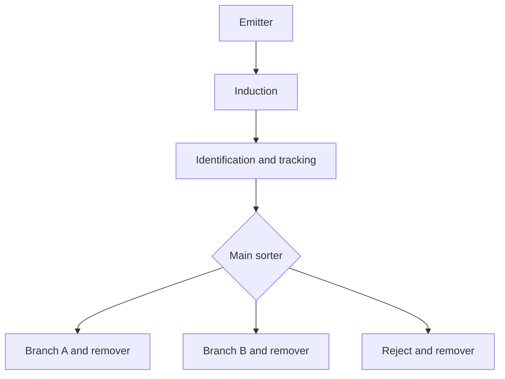

# Automated Fulfillment and Packaging Cell

**Author:** Frank Garcia  
**Platform:** Siemens S7-1200, TIA Portal V21, S7-PLCSIM, Factory I/O  
**Release:** Portfolio Version 1.1  
**Status:** Commissioned and accepted for portfolio demonstration

## Project Summary

This project is a PLC-controlled fulfillment and packaging cell simulation that automatically emits, identifies, tracks, sorts, and removes products. A Siemens S7-1200 program coordinates the Factory I/O scene through deterministic state machines, product records, a circular queue, equipment feedback, timeout supervision, and operator recovery logic.

The completed system sends each product to one of three destinations:

1. Branch A
2. Branch B
3. Reject

The final endurance test completed **51 consecutive products** without record exhaustion, product pileup, an active fault, or manual intervention.

## Verified Results

| Measure | Result |
| --- | --- |
| Normal and fault FAT tests | 13 of 13 passed |
| Endurance run | 51 consecutive products |
| Available routes | Branch A, Branch B, and Reject |
| Discrete I/O documented | 39 BOOL points: 20 inputs and 19 outputs |
| Alarm conditions documented | 31 |
| Fault and safety scenarios executed | 8 |
| Additional alarms reviewed in code | 23 |
| Blocking commissioning defects | 0 |

## System Flow

## Control Design Highlights

- IEC 61131-3 Structured Control Language (SCL)
- Separate emitter and sortation function blocks
- Automatic single-product release with pulse, arrival, and spacing timers
- Sorter availability and route-complete handshake to prevent product pileup
- Twenty-position circular FIFO queue
- Reusable product-tracking records with explicit record release
- Cumulative `TotalCompleted` DInt independent of recycled record indexes
- Rising-edge detection for product and sensor events
- State-based timeout supervision with latched fault codes
- Every IEC timer called on every PLC scan for deterministic reset behavior
- Safe output defaults at the start of every scan
- Physical Start, Stop, Emergency Stop, and Reset controls
- Fault recovery through condition restoration, scene clearing, and PLC reset

## Important Final Mappings

| Function | PLC Address or Tag | Factory I/O Device |
| --- | --- | --- |
| Physical reset | `%I2.3 ResetPB` | Scene Reset Button |
| Emitter pulse | `%Q2.2 Emitter_Emit` | Emitter 0 Emit |
| Reject conveyor | `%Q1.3` | Rejected-product belt conveyor |
| A remover | `%Q1.7` | Branch A Remover |
| B remover | `%Q2.0` | Branch B Remover |
| Reject remover | `%Q2.1` | Reject Remover |

The authoritative point-by-point mapping is in `Documentation/IO_List_Automated_Fulfillment_Cell.xlsx`.

## Commissioning Corrections

The following issues were found and corrected during commissioning:

- Connected the Factory I/O emitter to `%Q2.2` after Start initially produced no boxes.
- Added sorter reservation, completion-handshake states, and single-product backpressure after boxes accumulated.
- Corrected the reject conveyor and outfeed/remover device mappings.
- Released completed product records so operation could continue beyond the 20-record array capacity.
- Added `TotalCompleted` because `CurrentIndex` and `RoutedIndex` are reusable record indexes, not lifetime production counters.
- Qualified timer enables by the state active at scan start to prevent expired timers from carrying into later states.
- Mapped the physical scene Reset Button to `%I2.3 ResetPB` instead of the built-in Factory I/O reset function.

The full problem, cause, correction, and verification history is in `Documentation/Commissioning_Report_Automated_Fulfillment_Cell.docx`.

## Portfolio Contents

### Documentation

- `Functional_Design_Specification_Automated_Fulfillment_Cell.docx` — functional requirements, sequence, interfaces, alarms, and acceptance criteria.
- `IO_List_Automated_Fulfillment_Cell.xlsx` — final input/output map and device assignments.
- `Alarm_Matrix_Automated_Fulfillment_Cell.xlsx` — fault codes, triggers, actions, recovery, and validation status.
- `FAT_Test_Matrix_Automated_Fulfillment_Cell.xlsx` — thirteen executed acceptance tests and results.
- `Commissioning_Report_Automated_Fulfillment_Cell.docx` — commissioning findings, corrections, evidence, endurance results, and handoff status.

### PLC Source

- `FB_EmitterController_Handshake.scl` — final automatic emitter controller with sorter handshake.
- `FB_SortationController_RecordRecycle.scl` — final sorter controller with routing, alarms, record recycling, and `TotalCompleted` counting.

### Evidence

- `Factory_IO_Final_Scene.png` — completed Factory I/O cell.
- `Operator_Controls.png` — Start, Stop, Emergency Stop, and physical Reset controls.
- `TIA_FaultCode_402.png` — online evidence of the Pusher B front-limit timeout test.

### Native Project Files

The `Automated_Fulfillment_Cell_Native_Project` folder contains the files needed to review and run the simulation:

- `Automated_Fulfillment_Cell_TIA_V21.zap21` — complete TIA Portal V21 project archive.
- `Automated_Fulfillment_Cell.factoryio` — Factory I/O scene.
- `FactoryIO_Siemens_IO_Mapping.xml` — exported Siemens driver and I/O mapping.

Running the native project requires compatible installations and licenses for TIA Portal V21, S7-PLCSIM, and Factory I/O. The documentation and exported SCL source can still be reviewed without running the simulation.

## Demonstration Procedure

1. Open the TIA Portal project and start S7-PLCSIM.
2. Place `PLC_1` in RUN and confirm that no CPU error is active.
3. Open the Factory I/O scene and connect its Siemens driver to S7-PLCSIM.
4. Confirm that Emergency Stop is released and both pushers are at their back limits.
5. Press the physical Reset Button, then press Start once.
6. Observe automatic product emission, tracking, routing, removal, and the cumulative `TotalCompleted` count.
7. Demonstrate Branch A, Branch B, and Reject destinations.
8. If demonstrating a fault, disconnect only the selected test point, observe the expected code and `State 900`, restore the point, clear the scene, reset, and complete a normal route.

## Interview Summary

> I designed and commissioned a Siemens S7-1200 fulfillment-cell simulation in TIA Portal and Factory I/O. I implemented SCL state machines, a reusable twenty-record tracking system, circular FIFO routing, emitter-to-sorter backpressure, deterministic IEC timer handling, and fault recovery. I documented 39 discrete I/O points and 31 alarm conditions, passed all 13 FAT tests, and completed a 51-product unattended endurance run.

## Resume Bullet

- Developed and commissioned a Siemens S7-1200 automated fulfillment-cell simulation using TIA Portal, S7-PLCSIM, Factory I/O, and SCL; implemented product tracking, FIFO sortation, three-route control, interlocks, timeout alarms, and recovery logic, achieving 13/13 FAT passes and a 51-product unattended endurance run.

## Scope and Safety Notice

This release is a software and controls portfolio simulation. It is not a safety-certified control system and is not approved for physical production machinery. A real installation would require site-specific electrical design, risk assessment, safety-rated hardware and logic, guarding, commissioning, and regulatory acceptance.
